<!-- SPDX-License-Identifier: GPL-3.0-or-later -->
<p align="center">
  
</p>

<h1 align="center">Photos</h1>

<p align="center">by <b>RatioJuris</b> · owned by <b>PrajnaBytes International Private Limited</b></p>

<p align="center">
  A calm, iOS-style photo gallery for Android — with photos you can lock behind a password<br/>
  that still look like ordinary pictures to everyone else.
</p>

<p align="center">
  Version 1.0.0 · Android 12+ · No account · No cloud · No tracking · Free software (GPL-3.0-or-later)
</p>

---

## Screenshots

| Library | Months | Albums |
|:-:|:-:|:-:|
| 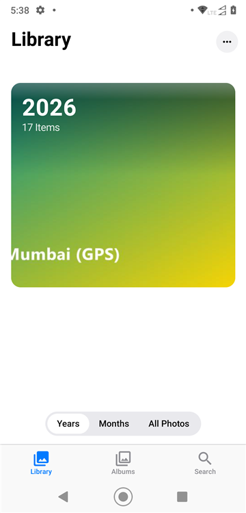 | 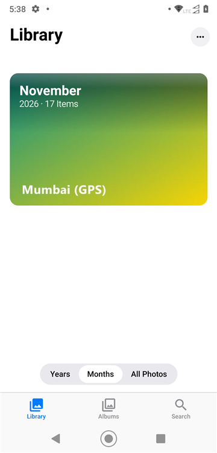 | 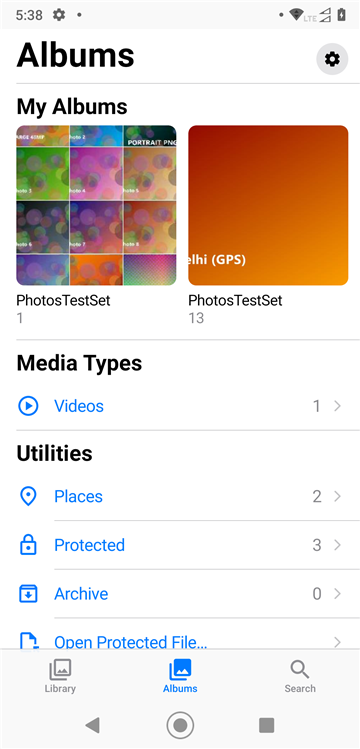 |

| Viewer | Protect a photo | A protected photo |
|:-:|:-:|:-:|
| 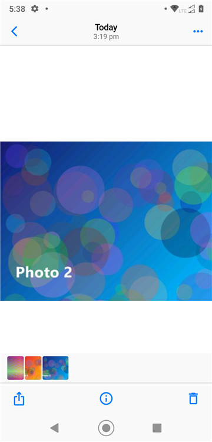 | 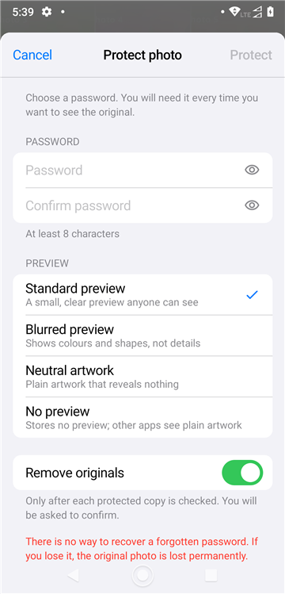 | 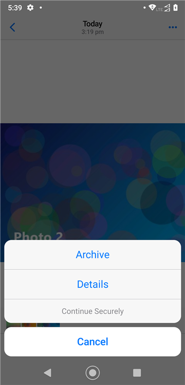 |

| Places | Location in Details | What other apps see |
|:-:|:-:|:-:|
| 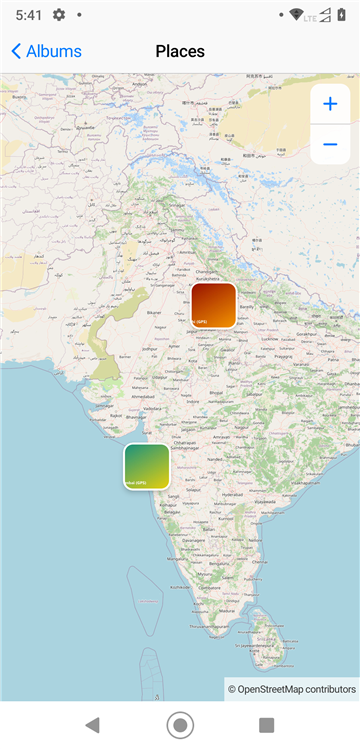 | 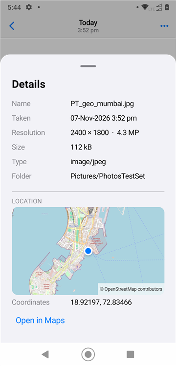 | 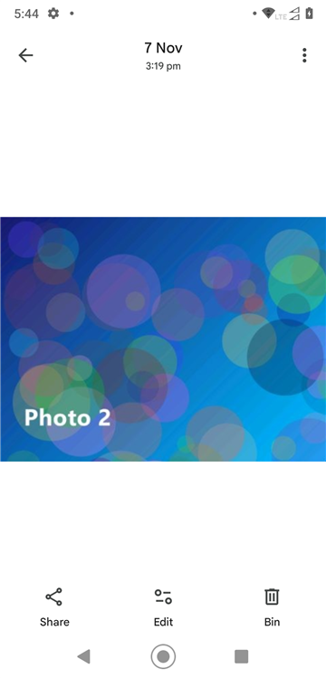 |

| Settings | Dark appearance |
|:-:|:-:|
| 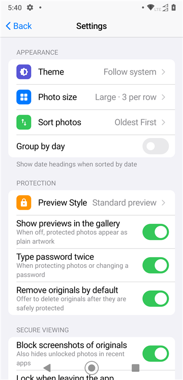 | 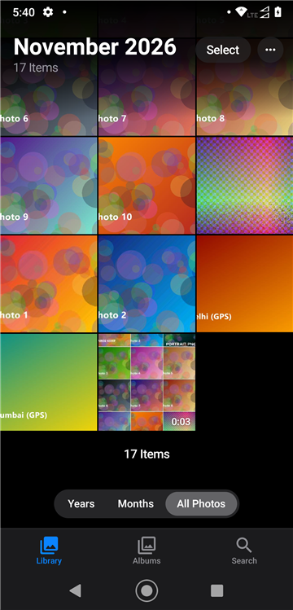 |

<sub>Screenshots of Photos v1.0.0 on Android 10, with test images only.</sub>

---

## What you can do

### Browse your photos and videos
- **Library** with *Years*, *Months* and *All Photos*. Like iOS, the newest photo is at the bottom and the
  library opens there.
- **Pinch the grid** to switch between 3, 5 and 7 photos per row.
- **Albums**: your folders, plus *Media Types* (Videos, Screenshots, Animated, RAW) and *Utilities*
  (Places, Protected, Archive, Bin).
- **Search** by file name, album or month ("March 2025").
- **Viewer**: pinch and double-tap to zoom, swipe left/right between photos, swipe **down** to close,
  swipe **up** for details. Keyboard and D-pad arrows work too.
- **Videos** play right in the viewer. (Protection is for photos only — videos are never encrypted.)
- **Select** several items to share, protect, archive or delete them. Long-press a photo for quick actions.

### Protect individual photos
1. Select one or more photos and tap the **lock**.
2. Choose a password and a preview style, then tap **Protect**.
3. Photos encrypts each original, checks that the protected copy opens correctly, and only then offers
   to remove the unprotected original.

A protected photo stays in your library and **looks like any other photo** — no padlock, no badge.
Other apps (and anyone you send it to) see only its preview.

To see the original, open the photo, tap **•••** and choose **Continue Securely**, then enter the
password. A wrong password simply leaves the preview on screen — nothing is announced.

While an original is on screen, screenshots are blocked, and it is cleared from memory when you leave
the app (both can be changed in Settings).

> **There is no password recovery.** If you forget the password, the original cannot be recovered by
> anyone — not by Photos, and not by the developer.

### Preview styles
| Style | What others see |
|---|---|
| Standard preview | a small, clear version of the photo |
| Blurred preview | colours and shapes only |
| Neutral artwork | a plain tile that reveals nothing |
| No preview | a plain tile; no preview is stored at all |

### Archive and Bin
- **Archive** hides photos from your Library, albums and search without deleting them
  (Albums › Archive). Archived files are not moved.
- **Bin** (Android 11+): deleted items can be recovered for up to 30 days. You can switch the Bin off
  in Settings.

### Places and maps
- Photo locations are read **on your device only** and shown in Details and on the Places map.
- **Maps are off until you turn them on.** Map images come from OpenStreetMap, whose servers then see
  which area you are viewing (never your photos). You can turn maps off and clear the map cache in
  Settings.

### Sharing
- **Share File** sends the protected photo as it is — the recipient sees the preview; with Photos
  and the password they can open the original.
- **Share Preview Image** sends only the preview.
- **Share Original…** appears only after you have unlocked the photo, and asks for confirmation.
- Tip: send protected photos *as files/documents*. Apps that recompress photos (for example some chat
  apps when sending "as photo") keep only the preview.

---

## Privacy

- No account, no server, no analytics, no ads.
- The only network use is map images, and only after you turn on Maps.
- Passwords are never stored. Unlocked originals stay in memory only; temporary copies made for an
  explicit "Share Original" are deleted automatically.
- Permissions: photos and videos (to show your library), media location (to show where photos were
  taken), internet (maps only).

## Requirements

- Android 12 (API 31) or newer.
- The Bin needs Android 11+ (always available on Android 12).

## Getting the app

There are no published builds yet. To build from source you need JDK 17+ and the Android SDK
(platform 36, build-tools 36.0.0), with `sdk.dir` set in a local `local.properties`:

```bash
./gradlew :phtx:test                     # format and crypto tests
./gradlew :app:assembleStandardRelease   # the app (Android 12+)
adb install -r app/build/outputs/apk/standard/release/app-standard-release.apk
```

Release signing uses a local, git-ignored `keystore.properties` (`storeFile`, `storePassword`,
`keyAlias`, `keyPassword`); without it, release builds are signed with the debug key for personal use.

See also [CHANGELOG.md](CHANGELOG.md), [CONTRIBUTING.md](CONTRIBUTING.md) and [SECURITY.md](SECURITY.md).
## License

Photos © 2026 RatioJuris. Owned by **PrajnaBytes International Private Limited**.

This program is free software: you can redistribute it and/or modify it under the terms of the
**GNU General Public License, version 3 or (at your option) any later version**. See [LICENSE](LICENSE).

### Third-party components
| Component | License |
|---|---|
| AndroidX, Jetpack Compose, Material components | Apache-2.0 |
| Coil (image loading) | Apache-2.0 |
| Kotlin, kotlinx.coroutines | Apache-2.0 |
| Bouncy Castle (Argon2id) | MIT-style Bouncy Castle Licence |
| Map data and tiles | © OpenStreetMap contributors, ODbL (shown in the app) |

### Notes
The look is inspired by the iOS Photos app. Photos is an independent project; it is not affiliated with
or endorsed by Apple or Google and contains no Apple or Google assets. The logo and app icon are original artwork
(Indian Marigold petals, *Tagetes erecta*), crafted by RatioJuris. Logo and app icon © 2026 Isrgrajan Gonardiya.
